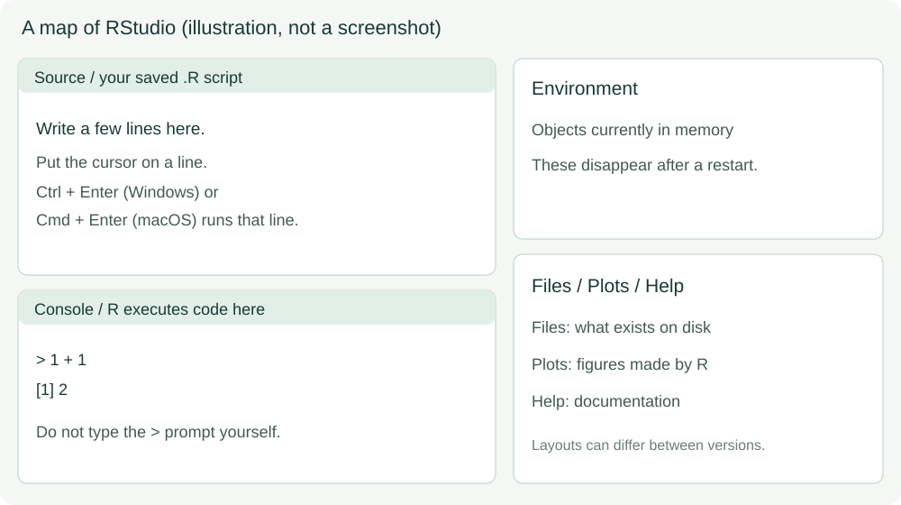

# 1. Your first successful run

**Your result:** a saved R script and a text file you can find again.

Follow the steps in order. Run the supplied code in your **my-** working copy.

## 1.1 Get the two tools

| Tool | What it does | Where to get it |
|---|---|---|
| R | Performs the calculations | [Official R downloads](https://cran.r-project.org/) |
| RStudio Desktop | Provides the editor, Console and file browser | [Official RStudio guide](https://docs.posit.co/ide/user/download.html) |

Install R first, then RStudio. On Windows choose R's base installation. On macOS choose the installer for your processor, following the download page's compatibility notes. On a prepared lab computer, open RStudio and continue. Ask the TA for installation help if the computer is managed by your institution.

The student route needs no additional R packages.

## 1.2 Open the project and your working file

1. [Download the student ZIP](../downloads/microbial-ml-student.zip) and **extract it** into a folder you can find. On Windows use Extract All; do not work inside the ZIP preview.
2. Open `microbial-ml.Rproj` in RStudio. In **Files**, find `scripts` and `data`.
3. Choose **File → Open File**, open `scripts/01-first-run.R`, then **Save As** `scripts/my-01-first-run.R`.



*Illustration; pane positions can vary. [Official pane guide](https://docs.posit.co/ide/user/ide/guide/ui/ui-panes.html).*

Your script appears in **Source**. R's responses appear in **Console**. **Files** shows saved files; **Environment** lists objects currently in memory.

## 1.3 Run, then look

**Action 1 — Calculate.** Put the cursor on `1 + 1` and click **Run**, or press Ctrl + Enter on Windows / Cmd + Enter on macOS.

{{r:arithmetic}}

**Look for:** `2` in the Console. If R prints `[1] 2`, `[1]` is an output index. Do not type `[1]` or the prompt `>` yourself.

**Action 2 — Give a value a name.** Run the `object` block. To run several lines, select the whole block and click Run.

{{r:object}}

`<-` stores the value on the right under the name on the left. Quotes make `milk` text. The assignment normally prints nothing; the following `sample_name` line displays its stored value.

**Action 3 — Use a named number.** Predict the second line's result before running:

{{r:count}}

Then run `count` by itself. It remains 20: calculating `count * 2` did not store a new value in it.

**Stuck?** If the Console shows `+`, press Esc and run one complete line again. Other symptoms have a [short help route](../reference/troubleshooting.md).

## 1.4 Save a result and find it

First run `folder` to check that R is working inside the project:

{{r:folder}}

The folder's name may differ on your computer; the final result should be **TRUE**. If it is FALSE, reopen the `.Rproj` file.

Run `save` to make an output folder and write a text file. Keep the supplied settings for this step:

{{r:save}}

In **Files → outputs → practice**, find `first-run.txt`. Read it back:

{{r:inspect}}

**Save the script too:** use Ctrl/Cmd + S. Saving the `.R` file preserves your instructions. Running `writeLines()` creates the result file.

## 1.5 Try your first AI exchange

Use the course-approved chat; obtain its access link from the TA. If access is unavailable, continue with R and record the live-chat step as pending.

1. Start a new chat and send the prompt below.
2. Read the reply. If it contains code, copy only the R instructions, without triple backticks or prose.
3. At the end of your my- script, add `# My AI check`, paste or type the small check, save, select that block and Run.

```text
I am new to R. I ran count <- 20 and then count * 2.
Explain what count stores, what the second line prints, and how I can check
whether count changed. Use base R; do not add packages or an analysis pipeline.
```

**Accept the explanation only after checking:** run `count`. It should still be 20. Send your actual code and output back if the reply disagrees.

## 1.6 Restart and recreate

Save your my- script. Choose **Session → Restart R**, then run its blocks from the beginning. The earlier objects disappear from Environment; your script and text file remain on disk. Rerunning recreates the objects and output.

```{admonition} Ready to continue?
:class: tip
Find my-01-first-run.R and first-run.txt. Explain which contains instructions and which contains a result. Recreate the result after a restart.
```

**Try a change:** edit the message and output filename in your my- copy's `writeLines()` line. Run it and find both text files.

**Next:** [inspect a small table](02-minimum-r.ipynb).
