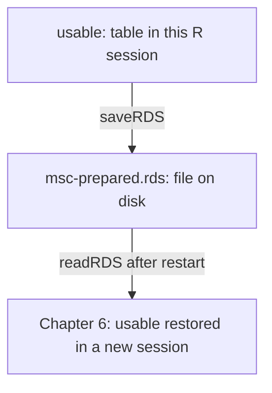

# 5. Meet the real milk data

**Open:** restart R and save the supplied script as `scripts/my-05-meet-real-data.R`.

**Question:** what does one row measure, and which records can we use for the MSC task?

## 5.1 Look at the measurements

**Study data.** We start with the study's **milk assay table**, which records laboratory tests on milk from organic farms. Each row records one test for one farm at one sampling round. A farm can have several rows from the same round because the lab ran different tests. For this project, we’ll select the rows for **mesophilic spore count (MSC)**. [Qian and colleagues (2025)](https://doi.org/10.1016/j.jfp.2025.100477)

In the block below, `source_file <- fetch_course_data()` downloads the CSV from a fixed version of the authors' GitHub repository and saves it in your project as `data/raw/Raw_Milk_Micro_Data.csv`. The function returns that local path as `source_file`, and `read.csv(source_file, ...)` reads the file into the table `milk`. On later runs, the function checks and reuses the saved copy. [View the authors' CSV](https://github.com/FSL-MQIP/OREI_ML_Inference/blob/aebcac0888599ad34ab2898f5aa2b704c6e7600c/Data/Raw%20Milk%20Micro%20Data.csv).

Run {span .script-block}`BLOCK · load-milk-data`. You can find the CSV in RStudio under **Files → data → raw**. Look for 2,736 rows and five column names in the output.

{{r:load-milk-data}}

Run {span .script-block}`BLOCK · raw-preview` to display the first three rows.

{{r:raw-preview}}

| Field | Read a row this way |
|---|---|
| `FarmID` | Which farm supplied the sample? |
| `Sampling` | At which sampling round? |
| `Test` | Which assay was performed? |
| `Conc` | What concentration was recorded for that assay? |
| `Notes` | Was the result qualified by a laboratory note? |

Read the first row across. Farm **R83** was sampled in round **G**, the test was **BAB**, and the lab marked the result as a **lab error**. Read `Test` and `Notes` alongside `Conc` to understand what a concentration means. The call to `head(milk, 3)` previews three rows from the full table.

**Optional inventory — {span .script-block}`BLOCK · list-assays`.** Expand to see all assay record counts. This display does not create an input needed later:

{{r:list-assays}}

## 5.2 Follow the selection rule

We choose **MSC: mesophilic spore count**, measured here in **CFU/mL**.

{span .script-block}`BLOCK · select-msc-records`

{{r:select-msc-records}}

| Selection | Records |
|---|---:|
| Start with MSC | 562 |
| Exclude records carrying a note | 37 |
| Retain no-note records with a positive, finite concentration | 525 |

**Read the column name:** NA in `Notes` means no note was recorded; it does not mean `Conc` is missing. A missing concentration and a missing note are different fields.

The notes comprise 34 laboratory errors, two TNTC results (too numerous to count), and one unresolved note. This is an explicit teaching eligibility rule; exclusion can affect which samples are represented.

Run {span .script-block}`BLOCK · filter-usable-msc-records`. `&` requires both conditions; `|` allows either. The supplied checks stop if the expected counts or unique farm-round keys differ:

{{r:filter-usable-msc-records}}

You should have **525 records from 102 farms**. Inspect three selected rows:

{span .script-block}`BLOCK · usable-preview`

{{r:usable-preview}}

Now every displayed concentration belongs to the same assay. If your count differs, check that you loaded the authors' CSV and ran the assay and eligibility filters in order.

## 5.3 Prepare the MSC prediction target

### Convert concentrations to log10

The **prediction target** is the value we want the model to predict. Here it is **log10 MSC**. Take the base-10 logarithm of each positive concentration's numeric value in CFU/mL. The result is the exponent on 10.

```{admonition} Invented data — read the log10 scale
:class: note

These example concentrations show how the conversion works.

$$
100=10^2 \qquad\Longrightarrow\qquad \log_{10}(100)=2.
$$

| CFU/mL | log10 value |
|---:|---:|
| 0.1 | −1 |
| 1 | 0 |
| 10 | 1 |
| 100 | 2 |

On this scale, each tenfold increase adds one unit. Going from 1 to 10 and going from 10 to 100 both add 1. Positive concentrations below 1 CFU/mL, such as 0.1, have negative log10 values.
```

### Mark results below the detection limit

**Study data.** The study reports a detection limit of **0.5 CFU/mL**. The authors stored below-limit results as **0.125 CFU/mL**, one quarter of that limit. The stored number represents a result below the limit. Its exact concentration remains unknown.

| Result in the source | How we handle it here |
|---|---|
| Missing concentration (`NA`) | Exclude it from the positive, finite concentrations selected in Section 5.2. |
| Recorded zero | Exclude it under the same selection rule. A log10 value requires a positive concentration. |
| Below-limit result stored as 0.125 | Keep the study's stored number and mark the record so we can check its effect on the test score in Chapter 7. |

Run {span .script-block}`BLOCK · create-log10-msc`. It creates the target column `log10_msc` and marks the 30 below-limit records with `left_censored = TRUE`.

{{r:create-log10-msc}}

### Compare averages on the two scales

```{admonition} Invented data — compare two ways to average
:class: note

Use three made-up concentrations to follow the calculation from start to finish.

| Step | Calculation |
|---|---|
| Start with concentrations | 1, 10 and 100 CFU/mL |
| Convert each to log10 | 0, 1 and 2 |
| Average on the target scale | `(0 + 1 + 2) / 3 = 1` |
| Express that fixed prediction as a concentration | `10^1 = 10` CFU/mL |
```

Run the supplied {span .script-block}`BLOCK · log-intuition` block on those same three invented values to check the calculation:

{{r:log-intuition}}

The original-scale arithmetic mean is **37 CFU/mL**. Taking the average on the log10 scale and converting it back gives **10 CFU/mL**, the geometric mean. Chapter 7 uses this second calculation to express its log10 prediction in CFU/mL.

**Check:** if each of 1, 10 and 100 increases tenfold, what happens to its log10 value? Each increases by 1.

## 5.4 Save the prepared input

**Back to the study data.** Select the supplied blocks from {span .script-block}`BLOCK · prepare-audit` through {span .script-block}`BLOCK · save-prepared`, then Run. They record the selection counts and write a checkpoint for the next session.

{{r:prepare-audit}}

{span .script-block}`BLOCK · save-prepared`

{{r:save-prepared}}



The file carries the prepared data and audit together. Restarting R clears the in-memory objects, while this file remains. You do not need to double-click the RDS file; Chapter 6's load block reads it.

**Find:** `outputs/checkpoints/msc-prepared.rds`. The existence check should be TRUE. Chapter 6 will read this file after a restart.

**Explain before moving on:** one real row, the MSC unit, the 525-record selection, and what the thirty encoded limit values mean. The [data sheet](../reference/data-audit.md) collects these decisions for reference.

**Next:** [Split the data by farm](06-split-farms.ipynb).
