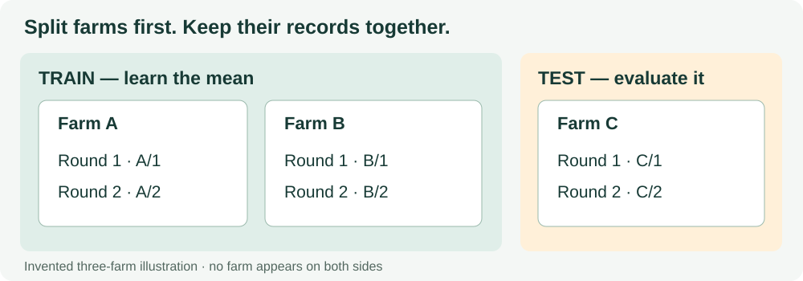

# 6. Split the data by farm

**Open:** restart R and save the supplied script as `scripts/my-06-split-farms.R`.

**Input:** `outputs/checkpoints/msc-prepared.rds` from Chapter 5.

## 6.1 Choose the unit to hold out

Our question is prediction for a **farm not used to learn the rule**. All records from a selected farm must therefore stay together.

*The three example farms from Chapter 4, with both sampling rounds kept together for each farm.*

A row-wise split can put records from the same farm on both sides. It then answers a different prediction question.

**Check:** seeing a second sample from farm A is not the same as seeing a farm for the first time. Which situation matches our question?

## 6.2 Load and make the real split

**Study data.** Run the supplied {span .script-block}`BLOCK · load-prepared` block to reload the saved table. After a restart, an empty Environment is expected. This block reads the disk checkpoint with `readRDS()`, then takes its `data` item as `usable`. If the file is missing, complete Chapter 5 first:

{{r:load-prepared}}

**The decision:** hold out 20% of the 102 farms, rounding up to 21. Use the supplied seed, 2026, to repeat this selection. Keep these choices fixed while learning the procedure.

The code draws farm IDs first. Every record whose farm is on that list goes into the test set, and the remaining records go into training.

Run the supplied {span .script-block}`BLOCK · split-by-farm` block unchanged. Expand its code if you want to inspect the random selection and row assignment:

{{r:split-by-farm}}

## 6.3 Read the checks as evidence

| Check | Supplied split |
|---|---:|
| Training farms | 81 |
| Test farms | 21 |
| Training records | 420 |
| Test records | 105 |

Record counts need not divide into exactly 80% and 20%, because farms contribute different numbers of records.

Run {span .script-block}`BLOCK · check-farm-overlap` to inspect the actual shared labels:

{{r:check-farm-overlap}}

**Expected:** `character(0)`, an empty list of farm labels. If you see any label, repair the split before fitting a model. This addresses farm overlap; it does not establish independence of every record or performance in a new region.

## 6.4 Save a starting point for evaluation

Run the supplied {span .script-block}`BLOCK · save-split` block:

{{r:save-split}}

**Find:** `outputs/checkpoints/farm-split.rds`. You can now restart R; Chapter 7 reloads the saved split.

**Explain before moving on:** why both samples from the same farm share a role, and why an empty farm intersection is a better check than row counts alone.

**Next:** [learn and evaluate a baseline](07-baseline.ipynb).
