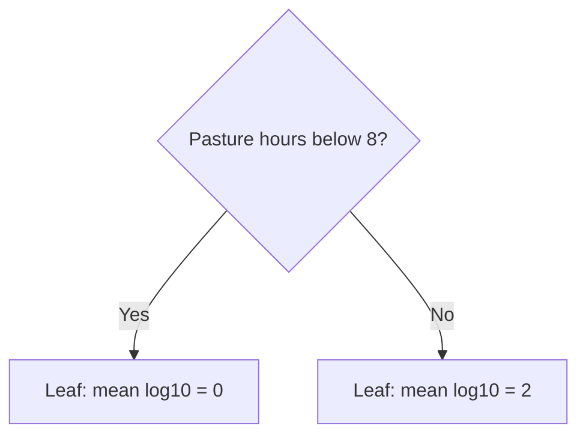
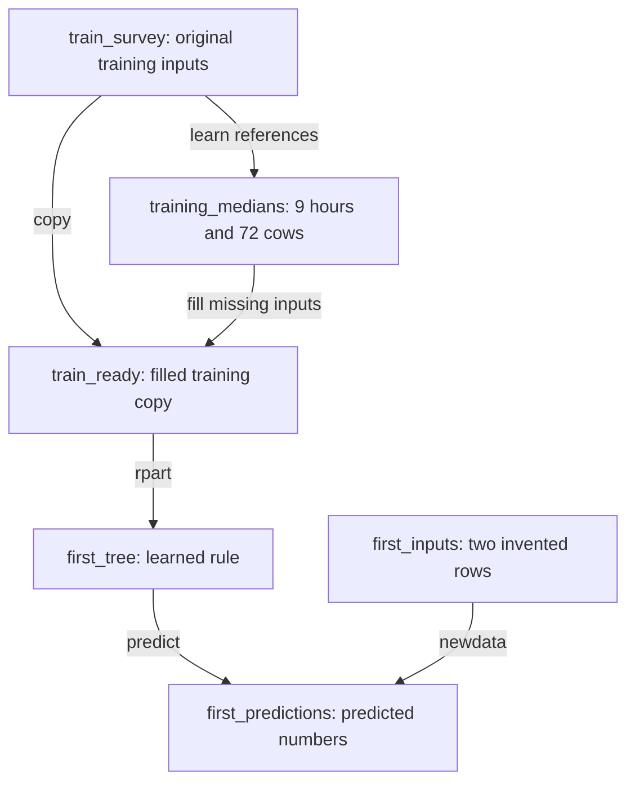

# 8. Can two averages beat one?

**Open:** restart R; save the supplied script as `scripts/my-08-first-tree.R`. Finish Chapter 7 first.

**Today:** build a rule by hand, fit a real tree, look at its branches and make two predictions. We will choose its depth in Chapter 9; no test score is needed today.

## 8.1 Install once, load each session

A **package** adds functions to R. We use the package **rpart** to fit a tree.

If you have not installed it, type this in the **Console** once. It needs internet; this installation line is not a step to repeat on every run:

```r
install.packages("rpart")
```

Then run the script's {span .script-block}`BLOCK · load-rpart-for-first-tree` block:

{{r:load-rpart-for-first-tree}}

Installing puts the package on your computer. `library(rpart)` makes its functions available in the current R session. After restarting R, run `library(rpart)` again; you usually do not need to install again. A successful load may print nothing. If it says there is no package called rpart, run the installation line above and retry the load.

**Supplied setup — {span .script-block}`BLOCK · load-farm-split-for-tree`:** run this block to restore Chapter 7's split. Its file checks are supporting code; they do not train a model.

{{r:load-farm-split-for-tree}}

## 8.2 Make two group averages yourself

These four records are **invented**. Their values make the arithmetic easy; they do not show a real effect of pasture time.

| Pasture hours/day | MSC CFU/mL | log10 MSC |
|---:|---:|---:|
| 0 | 1 | 0 |
| 4 | 1 | 0 |
| 12 | 100 | 2 |
| 16 | 100 | 2 |

Run {span .script-block}`BLOCK · hand-data` to create this table:

{{r:hand-data}}

**Guess:** what single log10 value would the Chapter 7 baseline give everyone? Run {span .script-block}`BLOCK · hand-mean`:

{{r:hand-mean}}

The answer is `(0 + 0 + 2 + 2) / 4 = 1`, equivalent to 10 CFU/mL.

Now **we choose** a cut at 8 pasture hours for this hand exercise. It is not a biological threshold. Software will later compare candidate cuts; we are not fitting software to these four rows.

Run {span .script-block}`BLOCK · hand-left`. The condition before the comma selects rows; the empty position after the comma keeps all columns:

{{r:hand-left}}

You should see the 0-hour and 4-hour records, then their mean log10 MSC: **0**.

Run {span .script-block}`BLOCK · hand-right`. `>=` means “greater than or equal to”:

{{r:hand-right}}

You should see the 12-hour and 16-hour records, then their mean: **2**.



A **leaf** is a final group. A new input follows the questions to a leaf and receives that group's training mean.

**Before running:** where does a new input of 6 hours go? Run {span .script-block}`BLOCK · hand-new`. Read `ifelse(question, yes_value, no_value)` as “choose this value if yes, otherwise that value”:

{{r:hand-new}}

It goes left: predict 0 log10 MSC, equivalent to `10^0 = 1` CFU/mL. We do not need its MSC result to make this prediction.

## 8.3 A perfect training fit can still surprise us

Run {span .script-block}`BLOCK · hand-errors`. The four group predictions are 0, 0, 2 and 2; `^2` squares each error:

{{r:hand-errors}}

The two printed squared-error sums are **4** for one mean and **0** for the two means.

Now invent one more record, specifically to challenge the rule: it has **6 pasture hours**, but its lab result turns out to be **100 CFU/mL**. This is a constructed counterexample, not a real survey observation.

| For this new record | Baseline | Hand-built tree |
|---|---:|---:|
| Prediction, CFU/mL | 10 | 1 |
| Prediction, log10 MSC | 1 | 0 |
| Observed log10 MSC | 2 | 2 |
| Observed minus predicted | 1 | 2 |

Run {span .script-block}`BLOCK · hand-surprise` to check the last row:

{{r:hand-surprise}}

**Explain:** which prediction missed by more on this record? A rule can perfectly match the records used to build it and still miss a new one. That is why we need hidden farms, not just a small training error.

**The baseline uses one training mean; a regression tree divides records into groups and uses each group's training mean.** Its software searches candidate cuts, then can repeat within groups. It does not search every possible complete tree.

**Pause point:** you have completed the hand-built rule and its counterexample. The rest of this chapter uses real data. If you stop here, save your my- script; next time restart R and run from the top to recreate its objects.

## 8.4 Meet the real model's two inputs

We offer the real tree two survey answers from the sampling visit:

| R column | Meaning | Role |
|---|---|---|
| `pasture_hours` | Current hours per day on pasture | Possible input |
| `milking_cows` | Number of milking cows that day | Possible input |
| `log10_msc` | Lab MSC result on the log10 scale | Answer to learn from in training |

We assume the survey answers can be obtained before the lab result; an actual application must check that timing. Farm labels help match records and separate farms; they are not prediction inputs. Another assay result or a summary of microbial outcomes would not be an appropriate replacement for these survey inputs.

**Supplied data preparation — {span .script-block}`BLOCK · join-farm-survey`:** run this block. It downloads the fixed original survey and matches each record by **farm and sampling round**, preserving the original training/test roles.

{{r:join-farm-survey}}

Run {span .script-block}`BLOCK · predictor-preview` to inspect three training records. Read across a row: these two inputs accompany this known training answer.

{{r:predictor-preview}}

## 8.5 Give missing inputs an explicit rule

**Predict first:** does an unknown cow count mean zero cows? Run the supplied {span .script-block}`BLOCK · predictor-audit` block:

{{r:predictor-audit}}

There are **29 unmatched farm-round records**: 18 training and 11 test records. Two additional matched training records have unknown cow counts. We keep all 420 training and 105 test records for the same-sample comparison.

This is different from making up a missing lab answer:

| What is missing? | Our action | Why? |
|---|---|---|
| MSC answer | Do not invent an answer to train or score against | We do not know the correct result |
| Survey input | Fill a separate model-input copy using a training reference | The model needs a usable input; this is an explicit assumption |

Chapter 3 rejected silently treating an unknown count as zero. Here we deliberately state a different assumption for **prediction inputs**, preserve the recorded values and later evaluate the complete procedure. Filling an input does not recover its true measurement.

Our reference is the training **median**: sort the known values and take the middle one. The median of 30, 40 and 200 is 40. With an even count, average the two middle values.

Run {span .script-block}`BLOCK · median-example` on these invented cow counts. `[is.na(model_cows)]` selects only the missing positions:

{{r:median-example}}

**Check:** the recorded column still contains NA. Only the model copy uses 40.

Now run {span .script-block}`BLOCK · learn-training-medians` on the real **training** records:

{{r:learn-training-medians}}

The references are 9 hours and 72 cows. `[["milking_cows"]]` selects that named reference from `training_medians`. Run {span .script-block}`BLOCK · fill-missing-training-inputs` to copy the table and fill its missing inputs:

{{r:fill-missing-training-inputs}}

No test record helped calculate these references. Chapter 9 will apply the same rule separately inside each validation round.

## 8.6 Fit your first real tree and look at it

Use this object map to keep track of the names. These are objects in this R session; the diagram is a reading guide, not another block to run.



{span .script-block}`BLOCK · load-farm-split-for-tree` also provides `fixed_tree_settings`, the preset settings used below. `library(rpart)` loads functions; it does not create our tables or settings. The fitting and prediction steps create the last two objects as you proceed.

**Fit** means use training records to learn a rule. Run {span .script-block}`BLOCK · fit-first-tree`:

{{r:fit-first-tree}}

Read the fitting call in pieces:

| Code | Meaning |
|---|---|
| `first_tree <- rpart(...)` | Learn a tree and store it as `first_tree` |
| `log10_msc ~ pasture_hours + milking_cows` | Predict log10 MSC using these two possible inputs |
| `data = train_ready` | Learn from the prepared training table |
| `method = "anova"` | Tell rpart this is a numeric prediction task |
| `first_settings$maxdepth <- 1` | Allow at most one question along a path |

Here `~` means “predict using”; `+` lists inputs, rather than adding hours to cows. The supplied `fixed_tree_settings` holds the other settings constant. Copy it, then set the visible depth. You do not need to write a settings helper. Optional details are in [the fixed settings note](../reference/data-audit.md#tree-settings).

The depth of 1 is a **starting demonstration**, not a decision that it is best. We have not calculated a tree test score.

**Supplied plot — {span .script-block}`BLOCK · first-plot`:** run this block, then open `outputs/tree/first-tree.png` in Files. It saves the image directly; it may not appear in the Plots pane.

{{r:first-plot}}


The software chose a question about **milking cows**, not pasture hours. Its cut at 36.5 separates integer counts of **36 or fewer** from **37 or more**. There is no half cow. The cut was learned from these training records; it is not advice to change herd size or a milk-safety threshold.

## 8.7 Predict by eye, then use predict()

The next two inputs are **invented** and have no known MSC results. Run {span .script-block}`BLOCK · first-inputs`:

{{r:first-inputs}}

Before running the next block, point to the leaf for 50 cows, then for 30 cows. What log10 value should each receive? Run {span .script-block}`BLOCK · first-predict`:

{{r:first-predict}}

`predict(first_tree, newdata = first_inputs)` applies the learned rule to the new rows. It does **not** train again. Neither row needs an MSC column. Their predictions are about 0.6873 and 1.0545 log10 MSC. Without observed outcomes, these rows cannot tell us whether prediction is accurate.

**Explain:** which operation learned the branches, and which just followed them? Does changing pasture hours alone change this particular tree's prediction?

**Supplied save — {span .script-block}`BLOCK · save-tree-input`:** run this last block. It saves the original survey inputs, including their missing values, for Chapter 9 to prepare within each fitting round.

{{r:save-tree-input}}

**Find:** `outputs/checkpoints/tree-input.rds`, `outputs/tree/predictor-audit.csv` and `outputs/tree/first-tree.png`.

**Next:** [how deep should the tree grow?](09-choose-tree.ipynb)
