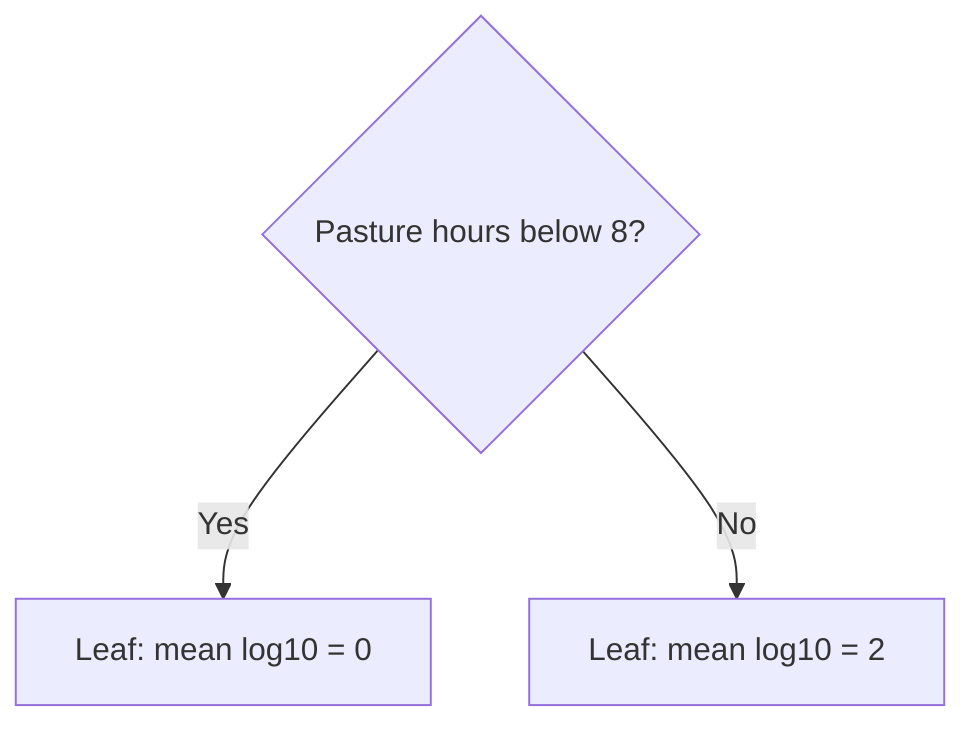

# 8. Can two averages beat one?

**Open:** restart R; save the supplied script as `scripts/my-08-first-tree.R`.

**Input:** the farm split from Chapters 6–7. **Question:** could different samples deserve different predictions?

## 8.1 Build the idea before using software

These four records are **invented**, chosen to make the arithmetic easy. They do not show a real effect of pasture time.

| Pasture hours/day | MSC CFU/mL | log10 MSC |
|---:|---:|---:|
| 0 | 1 | 0 |
| 4 | 1 | 0 |
| 12 | 100 | 2 |
| 16 | 100 | 2 |

One average predicts **1 on the log10 scale** for everyone. Its residuals are −1, −1, 1 and 1; their squared values sum to 4.

**Try first:** split at 8 pasture hours. What average would you predict in each group? Where would a new input of 6 hours go?

A **leaf** is a final group. The left leaf predicts `(0 + 0) / 2 = 0`; the right predicts `(2 + 2) / 2 = 2`. At 6 hours, predict 0 log10, equivalent to `10^0 = 1` CFU/mL. The training error becomes zero—but we have not checked any new farm.

This is the bridge: **the baseline uses one training mean; a regression tree divides records into groups and uses each group's training mean.** A tree's software searches for useful cuts, then repeats within groups. It does not search every possible complete tree.

## 8.2 Check the hand calculation in R

Run the supplied `tree-load` block. It reloads the existing split and checks for **rpart**, the R package used to fit trees:

{{r:tree-load}}

A package provides additional R functions. rpart comes with many R installations. If it is missing, the error gives a one-time Console installation command; install it, restart R and rerun the block. Chapters 1–7 continue to need only base R.

Run `hand-tree`:

{{r:hand-tree}}

**Check:** one mean gives squared-error sum 4; the two leaf means give 0. This is a hand-built rule, not a software fit to four records. Does zero training error alone establish useful prediction?

## 8.3 Choose information available before the answer

For the real tree, use two survey answers from the sampling visit:

| Predictor | Meaning | Before using it, ask… |
|---|---|---|
| `pasture_hours` | Current hours per day on pasture | Could the farm report this before the assay result? |
| `milking_cows` | Number of milking cows that day | Is this the count for the sampling visit? |

We assume these answers can be obtained before the lab result. That needs checking in an actual application. A predictor need not be a cause: a useful association would not prove that changing herd size or pasture time changes MSC.

Run the supplied `survey-source` block. It retrieves the fixed **original survey**, matches by farm **and** sampling round, and preserves the earlier outcomes and farm roles:

{{r:survey-source}}

Farm labels identify the join and split; they are not model inputs. We do not use another assay result, a summary calculated from microbial results, or the author's preprocessed combined table.

## 8.4 Inspect missing information

**Predict first:** if a survey answer is missing, does that mean zero pasture hours or zero cows?

Run `predictor-audit`:

{{r:predictor-audit}}

There are **29 unmatched farm-round records**, plus two unknown cow counts among matched training records. We keep all 420 training and 105 test records so the model comparison uses the same samples.

Our supplied missing-value rule is a training **median**: the middle value after sorting. For example, 30, 40 and 200 have median 40. With an even number of values, average the two middle values. An unknown value gets that training reference in a separate model-input table; the original answer remains missing. This is an assumption, not a recovered measurement.

Chapter 9 learns each median from the records fitting that particular tree. Hidden validation farms and final test farms cannot help choose it.

## 8.5 Save the input

Run `save-tree-input`:

{{r:save-tree-input}}

**Find:** `outputs/checkpoints/tree-input.rds` and `outputs/tree/predictor-audit.csv`.

**Explain before moving on:** what a leaf predicts, why the invented training error is insufficient, and why an unknown cow count is not zero.

**Next:** [let training farms choose the depth](09-choose-tree.ipynb).
