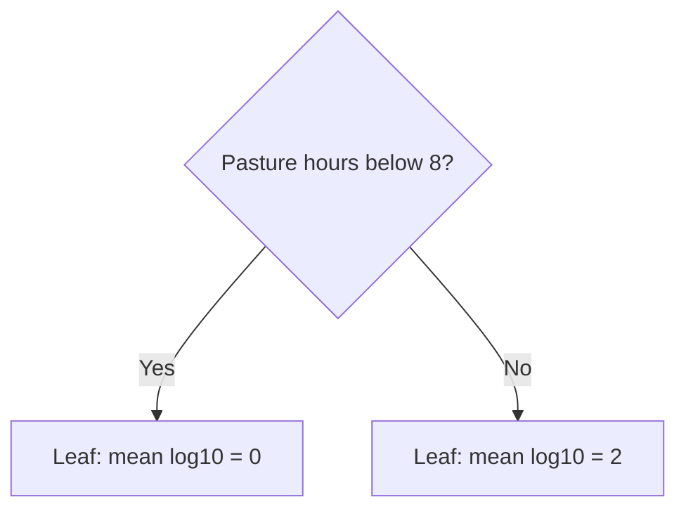
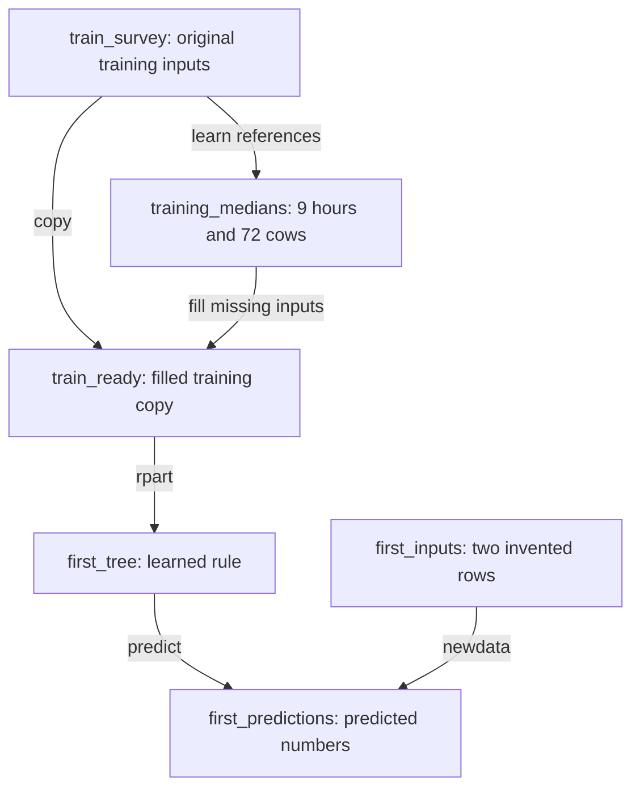

# 8. Can two averages beat one?

**Open:** restart R; save the supplied script as `scripts/my-08-first-tree.R`. Finish Chapter 7 first.

**Today:** build a rule by hand, fit a real tree, look at its branches and make two predictions. We will choose its depth in Chapter 9; no test score is needed today.

## 8.1 Install once, load each session

A **package** adds functions to R. We use the package **rpart** to fit a tree.

To install rpart for the first time, connect to the internet and run this line once in the **Console**:

```r
install.packages("rpart")
```

Then run the script's {span .script-block}`BLOCK · load-rpart-for-first-tree` block:

{{r:load-rpart-for-first-tree}}

Installing puts the package on your computer. Run `library(rpart)` in each new R session to use it. A successful load may print nothing. If R says there is no package called rpart, install it and retry the load.

Run {span .script-block}`BLOCK · load-farm-split-for-tree` to restore the split used in Chapter 7.

{{r:load-farm-split-for-tree}}

## 8.2 Make two group averages yourself

```{admonition} Invented data — build a tree by hand
:class: note

Use these four made-up records throughout Sections 8.2 and 8.3 to work out the group averages by hand.

| Pasture hours/day | MSC CFU/mL | log10 MSC |
|---:|---:|---:|
| 0 | 1 | 0 |
| 4 | 1 | 0 |
| 12 | 100 | 2 |
| 16 | 100 | 2 |
```

Run {span .script-block}`BLOCK · hand-data` to create this table:

{{r:hand-data}}

**Guess:** what single log10 value would the Chapter 7 baseline give everyone? Run {span .script-block}`BLOCK · hand-mean`:

{{r:hand-mean}}

The answer is `(0 + 0 + 2 + 2) / 4 = 1`, equivalent to 10 CFU/mL.

For this hand exercise, choose **8 pasture hours** as the dividing line. Later, R will compare candidate cuts using the study records.

Run {span .script-block}`BLOCK · hand-left`. The condition before the comma selects rows; the empty position after the comma keeps all columns:

{{r:hand-left}}

You should see the 0-hour and 4-hour records, then their mean log10 MSC: **0**.

Run {span .script-block}`BLOCK · hand-right`. `>=` means “greater than or equal to”:

{{r:hand-right}}

You should see the 12-hour and 16-hour records, then their mean: **2**.



A **leaf** is a final group. A new input follows the questions to a leaf and receives that group's training mean.

**Before running:** where does a new input of 6 hours go? Run {span .script-block}`BLOCK · hand-new`. Read `ifelse(question, yes_value, no_value)` as “choose this value if yes, otherwise that value”:

{{r:hand-new}}

It goes left: predict 0 log10 MSC, equivalent to `10^0 = 1` CFU/mL. We do not need its MSC result to make this prediction.

## 8.3 A perfect training fit can still surprise us

Compare the predictions on the same four invented training records. Every value in the last three columns is on the log10 scale.

| Pasture hours/day | Observed log10 MSC | One mean | Two group means |
|---:|---:|---:|---:|
| 0 | 0 | 1 | 0 |
| 4 | 0 | 1 | 0 |
| 12 | 2 | 1 | 2 |
| 16 | 2 | 1 | 2 |

As in Chapter 4, subtract the prediction from each observation, square the difference and add the four results.

$$
S_{\mathrm{one\ mean}}=(0-1)^2+(0-1)^2+(2-1)^2+(2-1)^2=4.
$$

$$
S_{\mathrm{two\ means}}=(0-0)^2+(0-0)^2+(2-2)^2+(2-2)^2=0.
$$

Run {span .script-block}`BLOCK · hand-errors` to check both totals.

{{r:hand-errors}}

```{admonition} Invented data — a new record challenges the rule
:class: note

Suppose a new record has **6 pasture hours** and its lab result comes back as **100 CFU/mL**.

| For this new record | Baseline | Hand-built tree |
|---|---:|---:|
| Prediction, CFU/mL | 10 | 1 |
| Prediction, log10 MSC | 1 | 0 |
| Observed log10 MSC | 2 | 2 |
| Observed minus predicted | 1 | 2 |
```

Run {span .script-block}`BLOCK · hand-surprise` to check the last row:

{{r:hand-surprise}}

**Explain:** which prediction missed by more on this record? A rule can perfectly match the records used to build it and still miss a new one. That is why we need hidden farms, not just a small training error.

**The baseline uses one training mean. A regression tree divides records into groups and uses each group's training mean.** It compares candidate cuts at each step and can then split the resulting groups again.

**Pause point:** you have completed the hand-built rule and its counterexample. If you stop here, save your my- script. Next time, restart R and run from the top to recreate its objects.

## 8.4 Meet the real model's two inputs

**Study data.** We offer the tree two survey answers from the sampling visit:

| R column | Meaning | Role |
|---|---|---|
| `pasture_hours` | Current hours per day on pasture | Possible input |
| `milking_cows` | Number of milking cows that day | Possible input |
| `log10_msc` | Lab MSC result on the log10 scale | Answer to learn from in training |

For this exercise, assume the farm can report pasture hours and cow count before the lab returns the MSC result. We use those two answers to predict MSC and the farm ID to match records and keep each farm together.

In the block below, `fetch_course_survey()` downloads the survey CSV from the authors' fixed GitHub version and saves it as `data/raw/Farm_Survey_Data.csv`. It returns the local path so `read_survey_features()` can read the file and select the two survey inputs. On later runs, the fetch function checks and reuses the saved CSV. [View the authors' survey CSV](https://github.com/FSL-MQIP/OREI_ML_Inference/blob/aebcac0888599ad34ab2898f5aa2b704c6e7600c/Data/Farm%20Survey%20Data.csv).

Run the supplied {span .script-block}`BLOCK · join-farm-survey`. It selects the two survey inputs and matches each record by **farm and sampling round**, preserving its training or test role.

{{r:join-farm-survey}}

Run {span .script-block}`BLOCK · predictor-preview` to inspect three training records. Read across a row: these two inputs accompany this known training answer.

{{r:predictor-preview}}

## 8.5 Give missing inputs an explicit rule

**Predict first:** does an unknown cow count mean zero cows? Run the supplied {span .script-block}`BLOCK · predictor-audit` block:

{{r:predictor-audit}}

There are **29 unmatched farm-round records**: 18 training and 11 test records. Two additional matched training records have unknown cow counts. We keep all 420 training and 105 test records for the same-sample comparison.

| What is missing? | Our action | Why? |
|---|---|---|
| MSC answer | Use records with an available outcome for training and scoring | Both steps need a lab result to compare with the prediction |
| Survey input | Fill a separate model-input copy using a training reference | This lets the model make a prediction for that record |

The filled value is a stand-in for prediction. The original survey table still shows which values were missing.

Our reference is the training **median**. Sort the known values and take the middle one. With an even count, average the two middle values.

```{admonition} Invented data — fill a missing cow count
:class: note

The middle value of 30, 40 and 200 is 40. Use 40 to fill the missing cow count in the model-input copy.
```

Run {span .script-block}`BLOCK · median-example` on those same invented cow counts. `[is.na(model_cows)]` selects only the missing positions:

{{r:median-example}}

**Check:** the recorded column still contains NA. Only the model copy uses 40.

**Back to the study data.** Run {span .script-block}`BLOCK · learn-training-medians` on the **training** records:

{{r:learn-training-medians}}

The references are 9 hours and 72 cows. `[["milking_cows"]]` selects that named reference from `training_medians`. Run {span .script-block}`BLOCK · fill-missing-training-inputs` to copy the table and fill its missing inputs:

{{r:fill-missing-training-inputs}}

Both references come from the training records. Chapter 9 will learn them separately in each validation round.

## 8.6 Fit your first real tree and look at it

Use this map to follow the R objects from the survey table to the predictions.



{span .script-block}`BLOCK · load-farm-split-for-tree` also provides `fixed_tree_settings`, the preset settings used below.

**Fit** means use training records to learn a rule. Run {span .script-block}`BLOCK · fit-first-tree`:

{{r:fit-first-tree}}

Read the fitting call in pieces:

| Code | Meaning |
|---|---|
| `first_tree <- rpart(...)` | Learn a tree and store it as `first_tree` |
| `log10_msc ~ pasture_hours + milking_cows` | Predict log10 MSC using these two possible inputs |
| `data = train_ready` | Learn from the prepared training table |
| `method = "anova"` | Tell rpart this is a numeric prediction task |
| `first_settings$maxdepth <- 1` | Allow at most one question along a path |

Read `~` as “predict using” and `+` as “and.” The block copies `fixed_tree_settings` and sets the depth limit to 1. See [the fixed settings note](../reference/data-audit.md#tree-settings) for the other settings.

One question is enough to practise reading a tree. Chapter 9 compares depth limits of 1, 2 and 3.

**Supplied plot — {span .script-block}`BLOCK · first-plot`:** run this block, then open `outputs/tree/first-tree.png` in Files. It saves the image directly; it may not appear in the Plots pane.

{{r:first-plot}}


The tree learned one question about **milking cows**. On the diagram, the cut at 36.5 separates herds of **36 cows or fewer** from herds of **37 or more**.

## 8.7 Predict by eye, then use predict()

```{admonition} Invented data — try two inputs on the fitted tree
:class: note

The tree learned its rule from the study records. Here we apply that rule to two made-up farm profiles with no measured MSC.
```

Run {span .script-block}`BLOCK · first-inputs`:

{{r:first-inputs}}

Before running the next block, point to the leaf for 50 cows, then for 30 cows. What log10 value should each receive? Run {span .script-block}`BLOCK · first-predict`:

{{r:first-predict}}

`predict(first_tree, newdata = first_inputs)` sends each row through the fitted tree using its inputs. Compare your answers with the two predictions, about 0.6873 and 1.0545 log10 MSC. Chapter 10 will score the tree using test records with lab results.

**Explain:** which operation learned the branches, and which just followed them? Does changing pasture hours alone change this particular tree's prediction?

**Back to the study data.** Run the supplied {span .script-block}`BLOCK · save-tree-input` block. It saves the original survey inputs, including their missing values, for Chapter 9 to prepare within each fitting round.

{{r:save-tree-input}}

**Find:** `outputs/checkpoints/tree-input.rds`, `outputs/tree/predictor-audit.csv` and `outputs/tree/first-tree.png`.

**Next:** [how deep should the tree grow?](09-choose-tree.ipynb)
