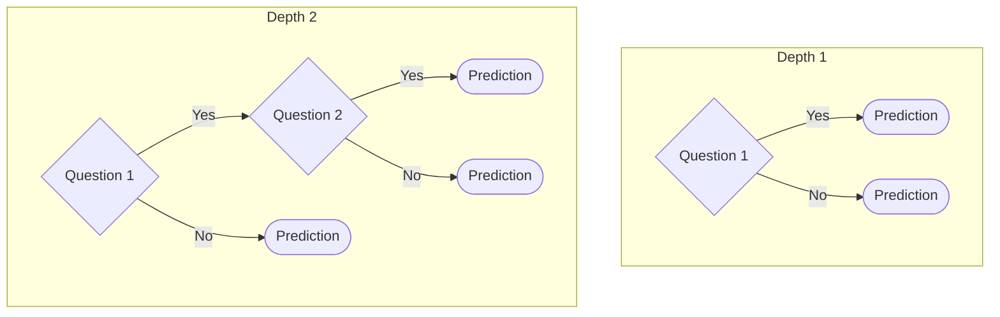
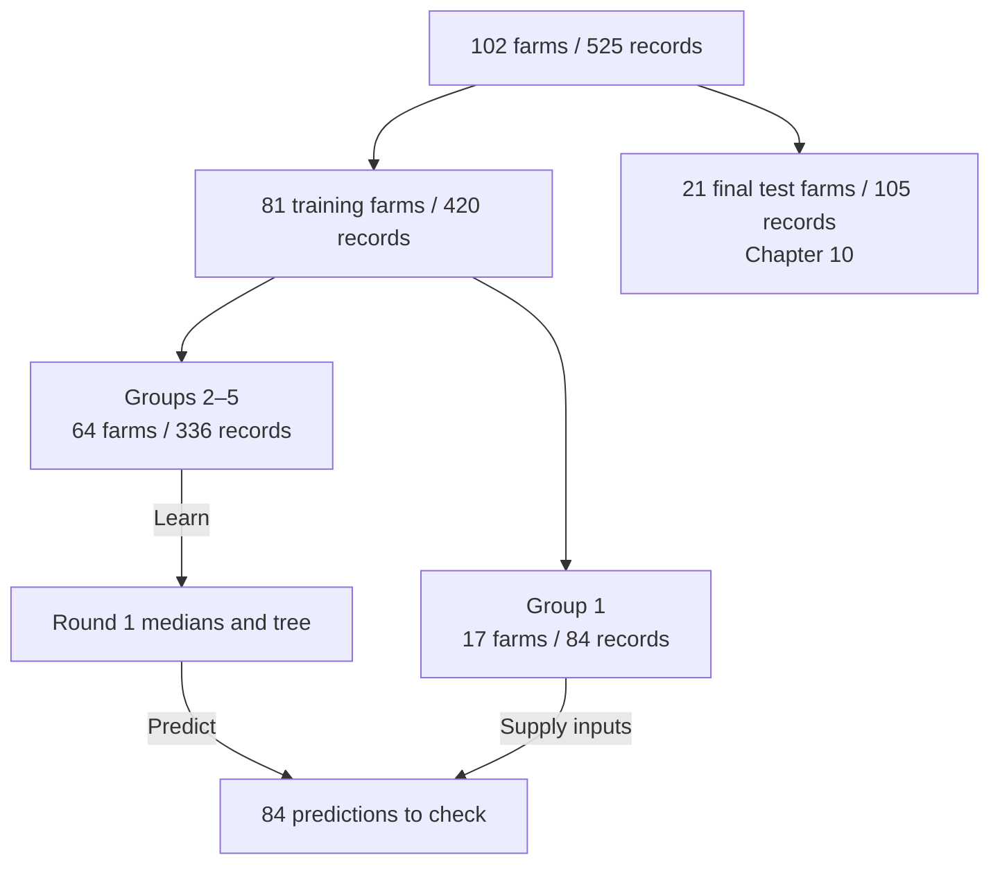

# 9. How deep should the tree grow?

**Would asking more questions help the tree predict MSC for a new farm?** Try one validation round, then repeat it to choose how deep the tree can grow. The 21 final test farms are reserved for Chapter 10.

**Open.** Restart R and save the supplied script as `scripts/my-09-choose-tree.R`. This chapter uses `outputs/checkpoints/tree-input.rds` from Chapter 8. Run the named blocks in order.

## 9.1 How many questions can a tree ask?

Follow one path from the first question to a prediction. Count the questions along the longest path in each diagram. This count is the tree’s **depth**.



When fitting a tree, **maximum depth** sets the number of questions it can ask along a path. A path can end sooner, as the first “No” branch of the depth-2 tree shows.

**Write your guess.** If we allow up to three questions along a path, will the tree’s error go up or down on the records it learned from? What about on farms it has yet to see? Save both guesses for Section 9.4.

Run {span .script-block}`BLOCK · load-rpart-for-validation` and {span .script-block}`BLOCK · load-tree-input` to load the package and study data.

{{r:load-rpart-for-validation}}

{span .script-block}`BLOCK · load-tree-input`

{{r:load-tree-input}}

Run {span .script-block}`BLOCK · depth-candidates`. We will try maximum depths 1, 2 and 3.

{{r:depth-candidates}}

## 9.2 Follow group 1 through one validation round

**Study data.** For this round, use a maximum depth of **1** and set aside **group 1**. The other four groups fit the tree. Group 1 gives us farms the tree has yet to see, so we can check how well it predicts their lab results. This check is called **validation**.



### 1. Fit with groups 2–5

Run {span .script-block}`BLOCK · training-folds` to assign the **81 training farms** to five groups, called **folds**. Every record from a farm receives that farm’s fold number.

{{r:training-folds}}

Run {span .script-block}`BLOCK · one-round-data`. Find the **336 records from 64 farms** for fitting and the **84 records from 17 farms** for validation.

{{r:one-round-data}}

Learn the medians from the fitting records. Use those medians for missing survey inputs in both groups.

```{admonition} Invented data — learn the median from fitting farms
:class: note dropdown

If the fitting farms have 30, 40 and 200 cows, their median is 40. A hidden farm with a missing cow count receives 40 in the model-input copy.
```

**Back to the study data.** Run {span .script-block}`BLOCK · one-round-prepare`. The cow median is **77.5**. It comes from this round’s fitting records. The median of **72** in Chapter 8 came from all 420 training records.

{{r:one-round-prepare}}

Run {span .script-block}`BLOCK · one-round-fit`. Find `data = fitting_ready` and `maxdepth <- 1` in the code. These show which records fit this tree and how many questions it can ask along a path.

{{r:one-round-fit}}

### 2. Predict group 1

Run {span .script-block}`BLOCK · one-round-predict` to predict all 84 records in group 1. The output shows the first record so you can follow it into the next section.

{{r:one-round-predict}}

Write down the two labels **R4** and **A**. Together they identify farm R4’s record from sampling round A. Its prediction is about **0.6842** on the log10 scale.

### 3. Check group 1’s predictions

Compare R4’s lab result, about **0.5441**, with its prediction. Use [Chapter 7’s subtraction](07-baseline.ipynb#id-7-2-check-one-prediction-by-hand). The prediction was about **0.1401** above the observed value on the log10 scale.

Now run {span .script-block}`BLOCK · one-round-error`. **RMSE ≈ 0.693** summarizes all **84** errors from group 1 for depth 1.

{{r:one-round-error}}

## 9.3 Combine the predictions from five rounds

Move the validation role from one group to the next. Each group takes one turn supplying records to check.

| Round | Group 1 | Group 2 | Group 3 | Group 4 | Group 5 |
|---|---|---|---|---|---|
| 1 | Check | Fit | Fit | Fit | Fit |
| 2 | Fit | Check | Fit | Fit | Fit |
| 3 | Fit | Fit | Check | Fit | Fit |
| 4 | Fit | Fit | Fit | Check | Fit |
| 5 | Fit | Fit | Fit | Fit | Check |

Run the supplied {span .script-block}`BLOCK · validate-depth`. It repeats the same fitting, predicting and checking steps for all five groups at each of the three depths.

{{r:validate-depth}}

**Find the same record.** Run {span .script-block}`BLOCK · trace-validation-record` to look up the farm ID and sampling round you wrote down.

{{r:trace-validation-record}}

Find **R4**, **A** and **fold 1** in the output. The `depth_1` value is about **0.6842**, the prediction you saw in Section 9.2. It came from the round in which group 1 was held out.

A prediction made while its group is held out is called an **out-of-fold prediction**, or **OOF prediction**. For each depth, the five rounds supply one such prediction for every training record. We combine all **420** errors into one RMSE per depth. Chapter 7 used the same calculation on the final test records. Here the errors come from the five groups inside the training set.

```{admonition} How the five groups make one RMSE
:class: note dropdown

For one depth, let $S_k$ be the sum of squared errors for the records held out in round $k$. Add the five sums, divide by the 420 records, and take the square root.

$$
\mathrm{RMSE}_{\mathrm{OOF}}=\sqrt{\frac{S_1+S_2+S_3+S_4+S_5}{420}}.
$$

Every record contributes one squared error, so a group with more records contributes more terms.
```

## 9.4 Choose a depth and check your guess

Choose the depth with the **smallest OOF RMSE**. If depths tie, choose the shallower one.

Run {span .script-block}`BLOCK · choose-depth`. The OOF RMSEs for depths 1, 2 and 3 are about **0.722**, **0.727** and **0.742**. Find the row with `selected = TRUE`. It marks **depth 1**.

{{r:choose-depth}}

**Return to your guess.** Run {span .script-block}`BLOCK · compare-training-and-validation-errors`. For each depth, read the error on the records used to fit the tree and the error on farms held out in validation.

{{r:compare-training-and-validation-errors}}

| Where we checked the predictions | What changed from depth 1 to depth 3? |
|---|---|
| The records used to fit the tree | Training RMSE fell from **0.701 to 0.677**. |
| Farms held out in each round | OOF RMSE rose from **0.722 to 0.742**. |

Which part matched your guess? Here, the deeper tree fit the known answers more closely, while the shallower tree predicted the held-out farms better.

**Compare with the baseline.** On those same validation records, the baseline’s OOF RMSE was **0.721**, slightly lower than the selected tree’s **0.722**. The baseline predicted each held-out group using the mean from that round’s fitting records.

## 9.5 Fit the final tree at the chosen depth

Each validation tree learned from four groups. We now know the depth and can fit the final tree using **all 420 records from the 81 training farms**. The comparison block in Section 9.4 already calculated the medians and prepared the inputs for this full training set. The final fit uses that prepared table to learn the branches and leaf means at depth 1.

**Check before running.** Which setting have we already chosen? What will the tree learn from the training data now?

Run {span .script-block}`BLOCK · fit-tree`. The result is stored as `final_tree`.

{{r:fit-tree}}

## 9.6 Save the tree for Chapter 10

Run {span .script-block}`BLOCK · save-tree-fit`. In **Files → outputs → checkpoints**, find **`tree-fit.rds`**. It contains the final tree and the training medians used to prepare inputs.

{{r:save-tree-fit}}

The tables in **outputs → tree** let you check your work later.

| File | What you can check |
|---|---|
| `validation-scores.csv` | Which depth had the smallest validation RMSE |
| `training-farm-folds.csv` | Which group each farm belonged to |
| `out-of-fold-predictions.csv` | The predictions for each record when its group was held out |

**Next.** Chapter 10 reads the saved tree and applies it to the **21 final test farms**. [Read the tree, predict and compare](10-test-tree.ipynb).
