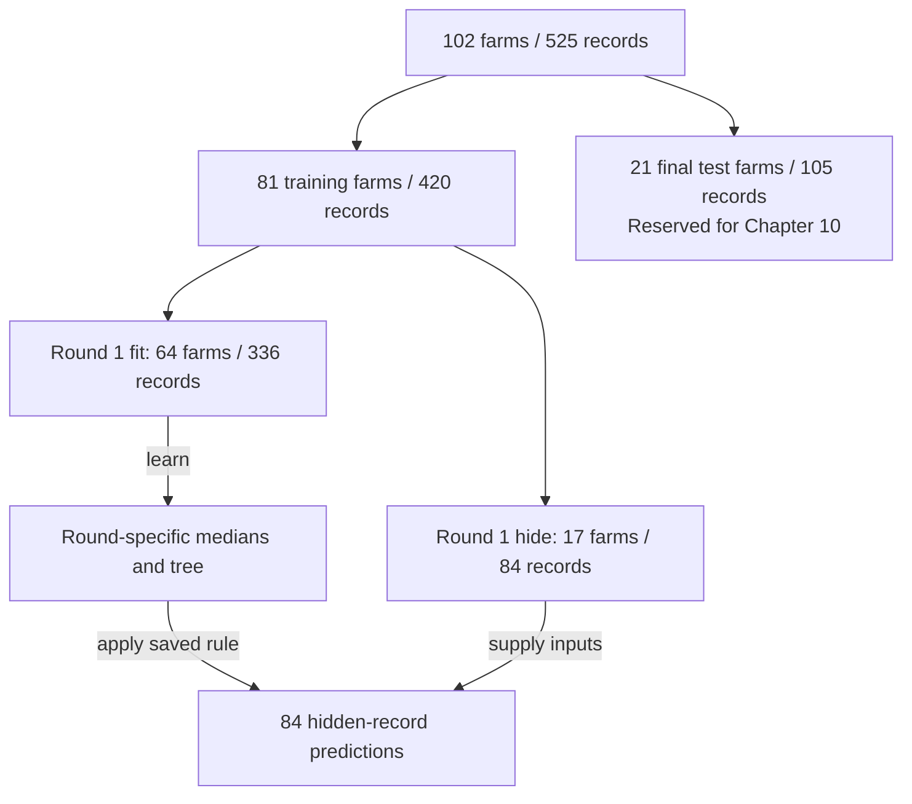

# 9. How deep should the tree grow?

**Open:** restart R; save the supplied script as `scripts/my-09-choose-tree.R`.

**Input:** Chapter 8's `tree-input.rds`. **Today:** repeat the fit/predict operations you know, using temporarily hidden training farms to choose depth. Keep the final test farms aside.

## 9.1 Make a guess before choosing

Chapter 8 fitted a tree with one question. A deeper tree can ask another question inside each group, creating smaller groups and more group averages.

**Write your guess:** would more questions improve the fit to known training records? Would they necessarily improve predictions for a new farm? Remember the invented 6-hour sample that broke our perfect hand-built rule.

Run {span .script-block}`BLOCK · load-rpart-for-validation`, then the supplied {span .script-block}`BLOCK · load-tree-input` block:

{{r:load-rpart-for-validation}}

{span .script-block}`BLOCK · load-tree-input`

{{r:load-tree-input}}

We will compare maximum depths **1, 2 and 3**. Run {span .script-block}`BLOCK · depth-candidates`; `1:3` lists those three integers:

{{r:depth-candidates}}

Depth counts questions along one root-to-leaf path. It does not count all the questions in the whole tree.

| Allowed depth | What it permits |
|---|---|
| 1 | One question, at most two final groups |
| 2 | A second question inside those groups, at most four final groups |
| 3 | A third question along a path, at most eight final groups |

The software can stop earlier; a depth limit is permission, not a requirement. It learns the cut positions, while we choose the allowed depth by checking predictions on hidden farms.

## 9.2 Try one validation round first

We have **81 training farms** and **21 final test farms**. To choose depth, split only the 81 training farms into five batches, called **folds**. All sampling rounds from a farm stay together.

**Supplied assignment — {span .script-block}`BLOCK · training-folds`:** run this block to assign those batches reproducibly. The displayed counts describe each batch when it is hidden:

{{r:training-folds}}

Start with batch 1. **Validation** means checking predictions for records that did not fit this particular tree. Run {span .script-block}`BLOCK · one-round-data`:

{{r:one-round-data}}

Read the table: **336 records from 64 farms** fit this tree; **84 records from 17 other training farms** check it. These 17 are temporarily hidden training farms, not any of the 21 final test farms.

Use this whole-course map for **round 1**. First split the 102 farms; only the 81 training farms enter the five-batch rotation. Counts describe farms and records separately.



In later rounds a different training batch is hidden; the 21 final test farms never move into the rotation.

**Missing inputs:** learn the medians from the 336 fitting records, then use those same references in both tables. For example, if known fitting counts were 30, 40 and 200, the reference would be 40 even if a hidden farm reported 1,200. Its value cannot redefine the reference.

Run the supplied {span .script-block}`BLOCK · one-round-prepare` block. It repeats Chapter 8's median-and-copy operations and displays the references learned for this round:

{{r:one-round-prepare}}

The cow reference is now **77.5**, rather than Chapter 8's 72, because this round has fewer fitting farms. It is the average of the two middle counts, a computed fill value rather than a measured half cow.

Now the familiar fitting step. Run {span .script-block}`BLOCK · one-round-fit`:

{{r:one-round-fit}}

**Find:** which table appears after `data =`? It must be `fitting_ready`, not the hidden validation table.

Run {span .script-block}`BLOCK · one-round-predict` to apply that tree to the hidden inputs:

{{r:one-round-predict}}

The observed values appear only to check the predictions. The fitting call did not use them. In `predict()`, the formula's right-hand inputs determine the prediction; an available answer column is not automatically another predictor.

Finally, run {span .script-block}`BLOCK · one-round-error` to summarize this round's errors with Chapter 7's RMSE calculation:

{{r:one-round-error}}

The RMSE of about **0.693** describes only this hidden batch and this depth. The depth choice below uses all five batches.

**Say the sequence:** learn from four batches → predict the fifth → compare with its answers. No final test score has entered this process.

## 9.3 Rotate the hidden batch

We do not want the choice to depend only on batch 1. Repeat the same steps until each training batch has been hidden once:

| Round | Batch 1 | Batch 2 | Batch 3 | Batch 4 | Batch 5 |
|---|---|---|---|---|---|
| 1 | Hide | Fit | Fit | Fit | Fit |
| 2 | Fit | Hide | Fit | Fit | Fit |
| 3 | Fit | Fit | Hide | Fit | Fit |
| 4 | Fit | Fit | Fit | Hide | Fit |
| 5 | Fit | Fit | Fit | Fit | Hide |

For each depth, every training record now has **one prediction made while its farm was hidden**. We call these **out-of-fold (OOF) predictions**. The 21 final test farms do not appear anywhere in this table.

Run the supplied {span .script-block}`BLOCK · validate-depth` block. It automates the one-round procedure for all five batches and all three depths. You do not need to write nested loops to understand what is being repeated.

{{r:validate-depth}}

The final OOF RMSE is calculated from all 420 hidden-record errors together, giving each record equal weight. Batch sizes differ, so it is not an unweighted average of the five RMSEs.

## 9.4 Let the validation table choose depth

Before this comparison, we fixed the rule: choose the **smallest OOF RMSE**, with a shallower tree winning a tie. MAE is also shown, but does not select depth.

Run the supplied {span .script-block}`BLOCK · choose-depth` block:

{{r:choose-depth}}

**Read it yourself:** depth 1 has OOF RMSE about 0.722, depth 2 about 0.727 and depth 3 about 0.742. Which is smallest? `selected = TRUE` marks that row. A slightly smaller MAE for depth 2 does not change the predeclared RMSE rule.

The baseline row below uses the fitting mean from each round to predict that round's hidden records. Its OOF RMSE is about 0.721. Choosing the best of three trees does not establish that it beats this simpler reference.

Do not compare 0.722 here directly with Chapter 7's test RMSE of 0.529: they concern different farms. Compare methods on the **same hidden records**.

## 9.5 Revisit your guess, then fit on all training farms

Run the supplied {span .script-block}`BLOCK · compare-training-and-validation-errors` block. It calculates the full-training medians and input copy again, then compares fit-to-training errors with OOF errors:

{{r:compare-training-and-validation-errors}}

**Return to your guess:** as allowed depth increases, training RMSE falls from about 0.701 to 0.677, but hidden-farm RMSE rises from about 0.722 to 0.742. More detailed groups fitted the known answers better without improving the hidden predictions here.

The extra training fits illustrate this difference; they do not alter the OOF choice. Depth is already selected. Now use **all 420 records from the 81 training farms** to learn the final tree. The medians again come from those training records only. Run {span .script-block}`BLOCK · fit-tree`:

{{r:fit-tree}}

There is no single validation-round tree to keep: each round had fewer fitting farms. This final fit uses all available training farms and the chosen setting. `final_tree` stores its learned branches and leaf means. We will use it on the 21 test farms in Chapter 10.

## 9.6 Save the choice

Run the supplied {span .script-block}`BLOCK · save-tree-fit` block:

{{r:save-tree-fit}}

**Find:** `outputs/checkpoints/tree-fit.rds`, `outputs/tree/validation-scores.csv` and `outputs/tree/training-farm-folds.csv`.

**Explain before moving on:** why are validation farms still part of the training set overall? Why do we fit once more after choosing depth? Which farms must stay out of both choices?

```{admonition} Check your explanation
:class: tip dropdown
Validation farms belong to the original 81 training farms: each batch is temporarily hidden while the others fit a candidate. After choosing depth, fit again on all 81 training farms because each round used fewer farms. The 21 final test farms help neither choose depth nor learn the tree or missing-input references.
```

**Next:** [read the tree, predict and compare](10-test-tree.ipynb).
