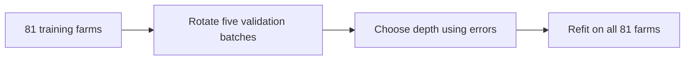

# 9. How deep should the tree grow?

**Open:** restart R; save the supplied script as `scripts/my-09-choose-tree.R`.

**Input:** Chapter 8's `tree-input.rds`. **Result:** one selected tree, before its test score is calculated.

## 9.1 Make a prediction about complexity

The invented example fitted its training records perfectly. Would allowing more splits make predictions for unseen farms better too?

**Write your guess:** a deeper tree's training error will usually decrease, but what might happen on farms it did not fit?

Run the supplied `load-tree-input` block:

{{r:load-tree-input}}

## 9.2 Tell R what to predict and what it may use

Run `tree-formula`:

{{r:tree-formula}}

Read `~` as “predict using”. Here `+` lists two candidate inputs; it does not add the hours to the cow count. `1:3` lists 1, 2 and 3. The tree may use either variable, both, or neither if no split is useful.

We compare maximum depths **1, 2 and 3**. Depth counts splits along one root-to-leaf path, not the total number of splits in the whole tree. Depth 1 allows one split from the root, giving at most two leaves. Depth 2 can split those groups again. The software learns cut positions; we choose the allowed depth using validation.

## 9.3 Hide training farms in turn

We already have **81 training farms** and **21 test farms**. To choose depth, divide only the 81 training farms into five batches, called **folds**. Fit using four batches and check predictions on the fifth; rotate until every training record has been checked once.

**Check:** all rounds from a farm stay in the same batch. A hidden batch contains temporarily held-out **training** farms. The 21 final test farms take no part in choosing depth.

Run the supplied `training-folds` block:

{{r:training-folds}}

The counts differ slightly across batches. The final score pools all 420 out-of-fold errors, giving each record equal weight; it is not an unweighted average of five RMSEs.

## 9.4 Choose using predictions for hidden farms

Run `validate-depth`. Its supplied loop learns medians inside each fitting batch, fills its hidden batch using those same medians, fits each candidate and stores the predictions. You may expand the implementation; you need to explain the information flow.

{{r:validate-depth}}

Then run the supplied `choose-depth` block:

{{r:choose-depth}}

**OOF** means **out of fold**: each prediction came from a tree that had not seen that record's farm. We fixed **smallest OOF RMSE** as the selection rule, with the shallower tree winning a tie. MAE is also reported, but does not choose depth.

**Find:** which row is selected? Does it also beat the training-fold-mean baseline shown below the table? Selecting the best of three trees does not establish that it beats a simpler reference.

Do not compare these validation scores with Chapter 7's test RMSE: they concern different farms. Compare methods on the **same held-out records**. Validation and final test scores need not match.

## 9.5 Fit the selected rule and challenge your guess

Run `fit-tree`. `rpart::rpart()` calls the fitting function from the rpart package; `method = "anova"` specifies a numeric regression target. `tree_control()` supplies the fixed settings and selected depth. The fitted medians now use all training records:

{{r:fit-tree}}

Check the median table: these values came from the training records. `final_tree` is the R object storing the learned rules and leaf means; Chapter 10 draws and checks them.

Run the supplied `training-check` to compare fitted training errors with hidden-farm errors:

{{r:training-check}}

**Return to your guess:** does a lower training error also give a lower OOF error here? Explain why choosing the smallest training error would answer the wrong question.

The extra training fits illustrate the difference; they do not change the depth already selected from OOF RMSE. We have not used a tree test score to choose predictors, depth or the missing-value rule.

## 9.6 Save the choice

Run `save-tree-fit`:

{{r:save-tree-fit}}

**Find:** `outputs/checkpoints/tree-fit.rds`, `outputs/tree/validation-scores.csv` and `outputs/tree/training-farm-folds.csv`.

**Ask AI:** give it the actual validation table and ask which depth follows the predeclared RMSE rule. Check its answer against the selected row. A persuasive explanation cannot justify switching criteria after seeing the scores.

**Next:** [predict, check and explain](10-test-tree.ipynb).
