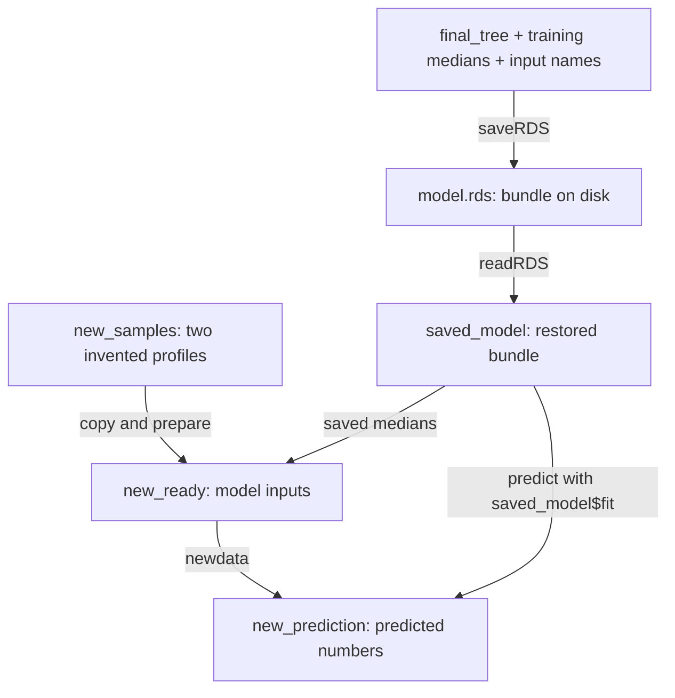

# 10. Predict, check and explain

**Open:** restart R; save the supplied script as `scripts/my-10-test-tree.R`.

**Input:** Chapter 9's saved tree. **Today:** read the learned rule, check its predictions, compare it with the baseline and reuse it on new inputs.

## 10.1 Read the tree before running predictions

Run {span .script-block}`BLOCK · load-rpart`, then the supplied {span .script-block}`BLOCK · load-tree-fit` block to restore the selected tree and its training preparation:

{{r:load-rpart}}

{span .script-block}`BLOCK · load-tree-fit`

{{r:load-tree-fit}}

Run the supplied {span .script-block}`BLOCK · plot-tree` block. Open `outputs/tree/fitted-tree.png` in Files; the code saves the image directly.

{{r:plot-tree}}


Chapter 9 selected depth 1 after comparing it with two deeper candidates. The resulting tree matches the one fitted to the study records in Chapter 8.

**Point before you run:**

| Input change | What do you expect from this tree? |
|---|---|
| 50 cows versus 30 cows | Which branch and leaf for each? |
| 50 cows becomes 60 | Does it cross the cut? |
| Only pasture hours changes | Is that variable used anywhere in this tree? |
| 36 cows becomes 37 | Does it cross the cut? |

```{admonition} Open after tracing the branches
:class: tip dropdown
50 and 60 cows both satisfy “at least 36.5”, enter leaf 2 and receive about 0.6873 log10 MSC. 30 and 36 enter leaf 3 and receive about 1.0545; 37 enters leaf 2. Changing pasture hours alone does not change this selected tree's prediction. All records in a leaf receive the same value.
```

## 10.2 Follow one real record and check its leaf

Run {span .script-block}`BLOCK · prepare-test` to fill missing test inputs with the saved **training** medians.

{{r:prepare-test}}

Run {span .script-block}`BLOCK · predict-tree`:

{{r:predict-tree}}

Here `predict()` applies the fitted tree to the prepared survey inputs. We use the test lab results to score those predictions.

Run the supplied {span .script-block}`BLOCK · trace-one-test-prediction` block. First compare recorded inputs with the model's inputs; then read the rule, leaf and prediction:

{{r:trace-one-test-prediction}}

The first record has **50 cows**. Follow “Yes” on the diagram to leaf 2 and read its prediction of about **0.6873 log10 MSC**. Subtract it from the observed value of about 0.8129 and check the result against the printed residual of **0.1256**. Use the [residual calculation from Chapter 4](04-small-farm-example.ipynb#id-4-4-turn-predictions-into-errors).

Where does 0.6873 come from? Run the supplied {span .script-block}`BLOCK · check-leaves` block:

{{r:check-leaves}}

One column calculates each leaf's average from its training records. The other reads the model's prediction. They agree: the first test record receives the mean of the 354 training records in leaf 2.

## 10.3 Compare predictions on the same test records

**Before running:** what evidence would justify the more complicated rule?

Run {span .script-block}`BLOCK · tree-errors`. The three lines calculate residuals, RMSE and MAE:

{{r:tree-errors}}

Then run the supplied {span .script-block}`BLOCK · tree-test-scores` block to place those scores beside the Chapter 7 baseline:

{{r:tree-test-scores}}

Both methods predict the **same 105 records from 21 held-out farms**, on the same log10 scale. The baseline has the lower RMSE (**0.529** versus **0.545** for the tree) and the lower MAE. The baseline also had a slightly lower RMSE in Chapter 9's training-only validation.

**Supplied evidence export — {span .script-block}`BLOCK · save-tree-results`:** run this block to save the comparisons and prediction checks.

{{r:save-tree-results}}

## 10.4 Save, reload and predict new inputs

This map connects the saved file to the objects you use for a new prediction:



A reusable prediction needs both the learned tree and the references for preparing missing inputs. A **list** bundles named R objects together; `$fit` later retrieves the item named `fit`.

Run {span .script-block}`BLOCK · save-model`. `saveRDS()` writes the bundle to a file:

{{r:save-model}}

Run {span .script-block}`BLOCK · reload-model`. `readRDS()` reads it back into R:

{{r:reload-model}}

```{admonition} Invented data — try the saved tree on two farm profiles
:class: note

Use the same two made-up inputs from Chapter 8 to check that the saved model makes predictions after you reload it. Neither profile has a measured MSC.
```

Run {span .script-block}`BLOCK · new-samples` to create those two profiles:

{{r:new-samples}}

**Predict first:** at 6 pasture hours, which leaf will 50 cows enter? Which will 30 cows enter?

Run {span .script-block}`BLOCK · prepare-new` to apply the saved input preparation. Both rows already have complete inputs.

{{r:prepare-new}}

Run {span .script-block}`BLOCK · new-predict`:

{{r:new-predict}}

The predictions are about 0.6873 and 1.0545 log10 MSC. The last column uses `10^prediction` to express them in CFU/mL. These two invented profiles have no measured MSC, so the exercise ends at prediction.

**Change one thing in your my- copy.** In {span .script-block}`BLOCK · new-samples`, change 50 cows to 60 and predict which leaf the profile will reach. To update the prediction, rerun {span .script-block}`BLOCK · new-samples` → {span .script-block}`BLOCK · prepare-new` → {span .script-block}`BLOCK · new-predict`. Next try 30 cows to 37, or change only pasture hours. Trace the branch to explain each result.

## 10.5 Ask AI for two familiar operations

Choose a chat from [AI access](01-first-run.ipynb#id-1-5-ai-access) and work in your **my- copy**.

**Back to the study data.** Ask AI to fit the tree on the training records and apply it to the held-out test records:

> I am using R and rpart. My prepared training data frame is train_filled. The numeric target is log10_msc; the only predictors are pasture_hours and milking_cows. selected_settings already contains my training-validation choice. My prepared held-out data frame is test_filled. Write only the code to fit a numeric regression tree called ai_tree on train_filled, then predict test_filled into ai_prediction. Do not change the settings, split or preparation. Do not use held-out outcomes for fitting or choosing settings. Explain which line learns and which line only predicts.

**Inspect before running:**

| Check in the returned code | Why it matters |
|---|---|
| Fitting `data` is `train_filled` | The model learns from the prepared training records |
| Left of `~` is `log10_msc`, and the right side lists only the two survey inputs | The formula separates the answer from the inputs |
| Numeric method and existing `selected_settings` are used | This is the procedure already chosen in training |
| `predict()` uses `newdata = test_filled` | We need predictions for those new rows |

Run {span .script-block}`BLOCK · restore-selected-tree-settings` to recreate the settings name in this session:

{{r:restore-selected-tree-settings}}

In your my- script, find the **My live AI attempt** comment at the end. Add the AI code below it, then add this check comparing its predictions with the reference `tree_prediction`. Run your added lines after completing the earlier blocks:

```r
all.equal(as.numeric(ai_prediction), as.numeric(tree_prediction))
```

Matching predictions return TRUE. If R reports a difference or an error, share the relevant code and output with AI to investigate. Add your prompt, reply, check and any repair to your AI-use log.

For a self-study route without live chat, inspect {span .script-block}`BLOCK · fit-tree` in Chapter 9 and {span .script-block}`BLOCK · predict-tree` here. Record that route as **code inspection**.

## 10.6 Keep the evidence and transfer the workflow

| Find in outputs/tree | What it lets you explain |
|---|---|
| `predictor-audit.csv` | Missing survey information and records kept |
| `validation-scores.csv` | Why this depth was selected |
| `test-scores.csv` | Same-record comparison with the baseline |
| `leaf-means.csv` and `nodes.csv` | Where the predictions came from |
| `model.rds` and `example-predictions.csv` | Reuse of the rule and its preparation |

**Write three sentences.** Name the candidate inputs and the depth selected in validation. Compare the test scores. Then explain one limitation, such as using training medians to fill missing survey inputs.

```{admonition} Reference conclusion — open after writing yours
:class: tip dropdown
The candidate inputs were pasture hours and milking-cow count, and five-fold validation within the training farms selected depth 1. On 105 test records from 21 held-out farms, the baseline had a lower RMSE than the tree, about 0.529 versus 0.545 on the log10 CFU/mL scale. The tree score includes predictions made with training medians in place of missing survey values.
```

| Step | When the algorithm changes |
|---|---|
| Define the task | Keep the target, available information and intended new-farm setting explicit |
| Prepare inputs | A new method may need different preparation; learn it inside each fitting partition |
| Fit and choose settings | Replace the fitting function and settings; keep whole-farm training validation |
| Predict and compare | Predict appropriate held-out records, without using their answers to choose the procedure |
| Explain and verify | Keep predictions and checks; a different model needs an explanation suited to its own rules |

**Your transfer worksheet:** before asking AI to help with another model, fill this table in your own notes. Use the current tree to practise filling the decisions; a future dataset may need different preparation or a different grouping unit.

| Decision | Write your answer |
|---|---|
| What is one record, and what numeric target should be predicted? | … |
| Which input columns exist before the target is known? | … |
| What related records must stay together? | … |
| Which data learn preparation and choose settings? | … |
| Which table fits the model, and which supplies new inputs? | … |
| What held-out comparison and evidence will you save? | … |

```{admonition} Check the worksheet for this tree
:class: tip dropdown
One record is one farm-round MSC result; the target is log10_msc. Inputs are pasture_hours and milking_cows, with availability before the lab result assumed. Keep each farm's records together. Learn preparation inside each fitting partition and choose depth within the 81 training farms. Fit the final rule on train_filled; predict the prepared held-out table test_filled. Compare its 105 predictions with the baseline using RMSE and MAE, and retain the split, preparation, predictions and checks.
```

**Finish:** save optional changed-input results under another filename if you want to keep them. Restart R and run a my- copy of `scripts/full-analysis.R`; it recreates the supplied reference baseline and tree from the original downloads.

The `source()` calls in `my-full-analysis.R` run the supplied reference workflows. To check your own edits, run the changed blocks in your my- chapter scripts. Explain which steps you can reuse when requesting another model from AI.
