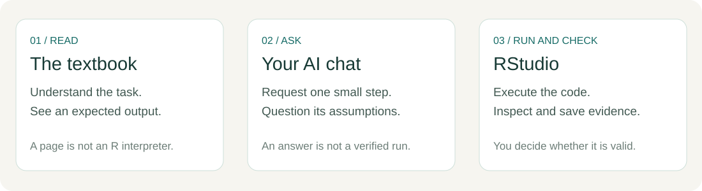

# 0. Start here

**Start with:** a browser. **Estimated reading:** 15–20 minutes; classroom timings have not yet been tested with beginners.

You know how a biological experiment produces measurements. This book adds a way to turn a small question about those measurements into code, inspect the result and save the evidence. No previous programming or AI experience is assumed.

## 0.1 A biological question and a small first result

A dairy study measured **mesophilic spore counts (MSC)** in milk from several farms. A farm was sampled more than once. We will ask: how well can a simple procedure predict the measurement of a sample from a farm it has not learned from? MSC is a microbial-quality endpoint here; it does not directly decide whether milk is safe to drink.

Our first procedure predicts the same training average for every new sample. This is a **baseline**: a measurable starting point for later methods. Imagine training counts of 10 and 30 CFU/mL. With no sample-specific information, predicting their average, 20, is a simple rule we can explain and check. Later, weather or management information might improve predictions; that improvement must be demonstrated.

We first practise with invented numbers, then use the study's real data. In the real analysis we will explain why the target uses a logarithm. You do not need that transformation yet.

| Word | Meaning in our project |
|---|---|
| Record | One assay result for one farm and sampling round |
| Outcome / target | The measurement we want to predict |
| Training data | Records used to learn the prediction rule |
| Test data | Held-out records used to evaluate the fixed rule |

## 0.2 Three places, three jobs



| Place | Your action | What it can see |
|---|---|---|
| This textbook | Read, compare outputs, open hints | The supplied teaching examples |
| An approved AI chat | Describe a task; paste relevant context and output | What you share or explicitly connect; opening a file in RStudio alone does not share it |
| RStudio | Edit a saved R script, run code, inspect files | Objects and files available in your R project |

The book's code-copy button copies text; it does not run R. Run R instructions in RStudio. Paste ordinary-language prompts into AI chat. We show exactly how at the first AI step in Chapter 1.

## 0.3 One working-file rule for every chapter

1. Open the supplied reference script, for example `scripts/02-minimum-r.R`.
2. Immediately use **File → Save As** to make `scripts/my-02-minimum-r.R`.
3. Work in your **my-** copy. Keep the reference available for comparison.
4. The reference already contains the code printed on the page. Find a named marker such as `# %% import` and run that block; you do not need to paste a second copy from the website.
5. Add or replace code only where the lesson tells you. Save before restarting R.

A chapter's opening card names its script, input, stopping point and output. Read it before running anything. A new R session starts without earlier objects; later chapters reload their saved input explicitly.

## 0.4 What will you hand over?

The student download has this structure. The `outputs` folder appears as you run lessons.

```text
microbial-ml/
  microbial-ml.Rproj
  scripts/                 reference scripts and your my- copies
  data/                    small practice inputs and data dictionary
  templates/               a completion card and an AI-use log
  outputs/                 created by your code
```

Open `.Rproj` to start the RStudio project. `.R` files contain instructions; `.csv` files contain tables. The Environment pane shows temporary objects in memory. Your saved scripts and output files remain on disk after R restarts.

For each chapter record four pieces of evidence: **my saved script, an output I found, a result I can explain, and a check I performed**. Use `templates/completion-card.txt` or a plain text note. At the end, you will also have a baseline score table, a plot and a short AI-use record.

## 0.5 How to learn with AI

Use this loop:

> State one task → share the necessary context → request one small step → run it → check the evidence → repair or accept → save.

You do not need to write every function from memory. You do need to identify its input, explain its purpose and recognise a meaningful check. Supplied technical checks are labeled; copying them does not replace understanding the scientific rule they enforce.

A course-approved AI chat is enough; no API key is needed. Obtain the course's approved access link from the TA before class. If access is temporarily unavailable, Chapter 3 supplies a clearly labeled illustrative dialogue. Record that route honestly and complete live-chat practice when access is available.

## Checkpoint 0

Before continuing, answer: where will code run, which file will hold your own edits, what is the outcome, and why do we start with an average?

```{admonition} Open after you try: a reference answer
:class: tip dropdown
R runs the calculations through RStudio. My edits go in a saved my- script. The real outcome is a milk MSC measurement; the early practice numbers are invented. The average supplies a simple reference prediction that later models can be compared with.
```

**Next:** [make your first successful R run](01-first-run.ipynb).
