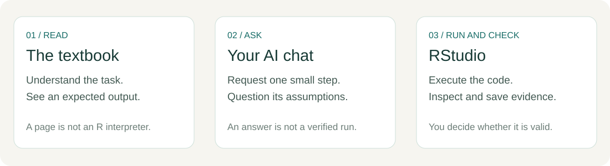

# Your first microbial ML project

**Machine Learning for Food Safety and Toxicology**

Start with a small question: how well can we predict the level of mesophilic spores in a milk sample from a farm we have not seen before?

This first edition takes you from opening RStudio to a complete, checked baseline analysis. You do not need previous programming or AI experience. You will ask AI for help, execute the code yourself, and decide whether the evidence supports the result.



## Follow this route

| Start | You will leave with |
|---|---|
| [0. Start here](chapters/00-start-here.md) | A clear task and an understanding of the three tools |
| [1. Your first successful run](chapters/01-first-run.ipynb) | A saved script and a file you can find |
| [2. The R you need today](chapters/02-minimum-r.ipynb) | The ability to inspect a small table |
| [3. Ask, run, inspect and repair](chapters/03-working-with-ai.ipynb) | A complete AI feedback loop and a saved evidence log |
| [4. Six records you can check by hand](chapters/04-small-farm-example.ipynb) | An understandable farm split, baseline and error calculation |
| [Real-data route: Chapters 5–7](chapters/worked-example.md) | Prepared data, a whole-farm split and an evaluated baseline |

Plan separate setup, practice and real-data sessions. Chapter times are estimates awaiting beginner trials; allow additional time for the exercises. Pause at each checkpoint. Time spent fixing a path or explaining a row is part of learning the workflow.

## Start with the student project

[Download the student project](downloads/microbial-ml-student.zip). Extract it before opening `microbial-ml.Rproj` in RStudio. Chapter 2 uses a four-row **invented practice dataset**; Chapter 4 adds a six-row invented farm example. Both are included in the download. The worked example downloads a fixed version of the authors' real data once, then checks its checksum.

The web pages show executed examples. To change and run them, use the downloaded R scripts in RStudio. Reading this static website does not start an R session.

## What this first edition covers

The revised beginner route includes Chapters 0–7, a complete training-mean baseline, collapsible reference answers, completion and AI-use templates, a data audit, a glossary and troubleshooting. Linear regression, Lasso, KNN, decision trees and random forests are later chapters in the course plan. They are not presented as completed lessons here.

The real case uses publicly accessible data linked by [Qian and colleagues (2025)](https://doi.org/10.1016/j.jfp.2025.100477). Read the [data audit](reference/data-audit.md) for the exact source, selection rules and limitations.

```{note} What counts as success?
You can explain what one row represents, run the script from the top, verify that training and test farms do not overlap, and reproduce the error calculation. A complicated model or a confident AI answer is not required.
```
